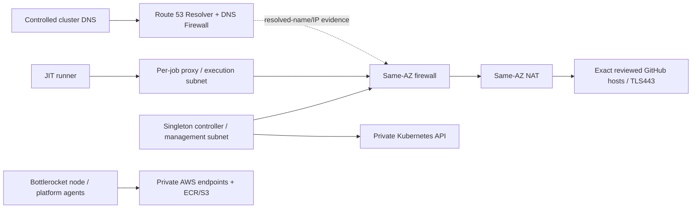

# RunSecure on private EKS with Bottlerocket

Illustrative deployment pathway, checked **2026-10-29 03:35–04:04 UTC** against the sources
linked below. This is not a commissioned cluster, a production certification, or
a claim of a SLSA level. No Terraform apply or EKS deployment accompanied this
example. Start with the [Terraform foundation](../examples/eks-bottlerocket/),
the [existing Helm chart](../charts/runsecure-orchestrator/), and the
[Kubernetes installation contract](../install-kubernetes.md). Supply qualified
versions and organization-specific inputs; do not apply placeholder files.

## What is enforced, and what remains gated

The Terraform creates a dedicated IPv4 VPC with two independent AZ inspection
lanes, a private-API EKS cluster, and separate Bottlerocket ARM64 management and
execution node groups. Every internet route from either private subnet goes
through its own AZ's Network Firewall endpoint and NAT gateway. NAT return
routes send the private CIDRs through the same endpoint. There is no direct NAT
fallback, public node IP, IPv6 egress path, inbound SSH, or public Kubernetes API.

The firewall permits TCP443 TLS only when **both** the visible SNI and the
destination address resolved by Route 53 match the same approved hostname.
Management sources may reach `api.github.com`; execution sources may reach only
the explicitly enrolled `github_execution_domains`. That set defaults empty,
so execution internet remains quarantined. Other protocols, ports, connections
without matching approved SNI/resolved-IP evidence and unapproved names fail
closed. A client using an already cached approved IP with matching SNI is not
distinguishable from one that just performed DNS. No plaintext HTTP,
UDP443/QUIC, generic AWS internet suffix or Azure storage suffix is allowed.
Application-layer default drop permits TCP setup and segmented ClientHello
traffic before SNI classification; it is not zero-packet withholding. The
first-packet resolved-IP validation still applies. [Evaluation behavior](https://docs.aws.amazon.com/network-firewall/latest/developerguide/suricata-rule-evaluation-order.html).

This uses **AWS provider 6.71.0**, whose released schema supports
`route53_resolved_ip_validation`. Earlier providers cannot express this control;
do not remove it to make validation pass. A policy-level resolved-IP check alone
accepts an address resolved for any domain. Each pass rule therefore also binds
that address to the exact GitHub name with `aws_route_53_resolved_domain` and
anchored SNI matching. See the [provider release](https://github.com/hashicorp/terraform-provider-aws/releases/tag/v6.71.0),
[AWS combined-rule example](https://docs.aws.amazon.com/network-firewall/latest/developerguide/route53-resolved-ip-validation-rules.html),
and [policy API](https://docs.aws.amazon.com/network-firewall/latest/APIReference/API_Route53ResolvedIPValidation.html).

These are **network destination controls**, not TLS server authentication or a
repository-level data-loss prevention boundary. DNS caches are shared within
the dedicated associated VPC scope; GitHub/CDN IPs may be shared, and approved
GitHub services can contain attacker-controlled repositories or content. TLS
certificate verification must remain enabled in clients. An assurance claim
about authenticated upstream identities or inspecting encrypted HTTP authorities
needs a separately reviewed terminating relay/TLS inspection design; it is not
provided here. SNI-only rules would allow manipulated-name attacks; standard
NetworkPolicy cannot filter FQDNs. [AWS domain-rule limits](https://docs.aws.amazon.com/network-firewall/latest/developerguide/stateful-rule-groups-domain-names.html).

Encrypted ClientHello with an allowed **outer** SNI and a matching shared
destination can pass; the firewall does not authenticate its inner name. Missing
or unapproved visible SNI has no pass rule. Do not claim this template detects
all ECH, encrypted HTTP authority changes or domain fronting.

## Private platform traffic is a separate trust path

Private traffic stays on VPC-local/interface/gateway endpoint routes and does
not inherit an internet firewall exception. The example provides private DNS
interface endpoints for EC2, ECR API/DKR, EKS management, EKS Auth, regional STS,
Logs and Secrets Manager, plus an S3 gateway endpoint restricted to ECR layer
downloads. The EKS management endpoint does **not** replace the Kubernetes API's
separate private endpoint. The example does not install a secrets synchronizer
or a log agent merely by providing their endpoints.

| Consumer | Necessary path | Required boundary |
|---|---|---|
| Controller | Kubernetes API exact Service/endpoint CIDR+port pairs; cluster DNS; GitHub API | Namespace RBAC and target-cluster Pod policy; management-source firewall API rule |
| Job runner | Selected cluster DNS and its own per-job proxy | No direct internet, private endpoint, other job or metadata access |
| Per-job proxy | Selected DNS; reviewed GitHub TLS destinations | RunSecure L7 allowlist plus independent VPC firewall |
| Node kubelet | Private API, exact private ECR registries and S3 layer bucket | Node role has named discovery actions and repository-scoped image downloads |
| CNI / Pod Identity | Private EC2 / EKS Auth | Separate CNI role associated only with `kube-system/aws-node`; no job association |
| Approved platform collectors | Logs / Secrets Manager / optional regional STS | Dedicated service account/role and exact resources; not the controller or runner identity |

Enumerate AWS-owned add-on ECR repositories as well as mirrored RunSecure
repositories in `pull_repository_arns`. Managed add-on images are not magically
redirected to your mirror. Mirror RunSecure images ahead of time from a trusted
publisher, preserve/verify the OCI manifest digest, and qualify ARM64 content.
Avoid pull-through-cache first-miss behavior requiring public upstream access.
No node publishing/deletion grant is included. See [private EKS dependencies](https://docs.aws.amazon.com/eks/latest/userguide/private-clusters.html)
and [ECR endpoint/S3 policy requirements](https://docs.aws.amazon.com/AmazonECR/latest/userguide/vpc-endpoints.html).

The node role's mandatory non-resource-scoped discovery, Pod Identity exchange
and ECR login actions use global resource scope with a region condition; actions
are named, not wildcarded. ECR image downloads use exact repository ARNs. The
S3 layer-bucket path and log-stream suffixes are bounded service-resource
patterns, not general S3 or CloudWatch access. Existing cluster/CNI/operator
roles must be independently reviewed before use; passing their ARN is not proof
of least privilege. Restrict CNI trust to this cluster and service account using
Pod Identity session tags and a confused-deputy boundary. See [node-role duties](https://docs.aws.amazon.com/eks/latest/userguide/create-node-role.html)
and [Pod Identity trust policy](https://docs.aws.amazon.com/eks/latest/userguide/pod-id-role.html).

For IRSA instead, use the regional STS endpoint, exact namespace/service-account
OIDC `sub` and `aud` trust, and an approved OIDC discovery/JWKS setup path. Do not
add both identity systems by accident. The baseline controller needs GitHub and
Kubernetes credentials, **no AWS role**; job Pods get no service-account token
or Pod Identity association. [IRSA isolation considerations](https://docs.aws.amazon.com/eks/latest/userguide/iam-roles-for-service-accounts.html).

## DNS, AZ locality and fail-closed behavior

Route 53 DNS Firewall allows only finite GitHub/platform names, inspects CNAME
redirections and blocks everything else. Its wildcard is a **deny catch-all**,
not an allow exception. Additional exact CNAME targets require review and do not
generate internet pass rules. A security group cannot filter the VPC Resolver;
the DNS Firewall is the outer control. Pod policy must additionally prevent
direct external DNS/DoT/DoH and unauthorized local resolver access.

Resolved-IP evidence is AZ-local. Normal CoreDNS Service load balancing can send
a lookup to another AZ, while the connection reaches the client's own firewall
AZ; that can correctly drop legitimate traffic. **AZ-local DNS is a deployment
prerequisite not automatically installed by this Terraform.** Qualify a pinned
NodeLocal DNS or equivalent same-AZ resolver design, its Bottlerocket/CNI
compatibility, and RunSecure's exact DNS peer configuration. Do not bypass IP
validation or permit all CNAME targets to resolve a bootstrap failure.

Associate the DNS rule group only with this dedicated VPC. Validation uses a
cache that can outlive the DNS TTL; `DNSExpiryExceptionPolicy=DROP` is not a
claim of immediate TTL revocation. Unsupported AZ, empty cache, DNS failure or
inspection-path failure must block, not fail over around inspection. Check
policy errors and every endpoint's resolved-domain attachment readiness, not
just an overall `ACTIVE` label. [AWS validation behavior](https://docs.aws.amazon.com/network-firewall/latest/developerguide/route53-resolved-ip-validation-how-it-works.html),
[troubleshooting](https://docs.aws.amazon.com/network-firewall/latest/developerguide/route53-resolved-ip-validation-troubleshooting.html),
[NodeLocal DNS design](https://kubernetes.io/docs/tasks/administer-cluster/nodelocaldns/).

## GitHub endpoint inventory and unsupported features

GitHub's [runner communication inventory](https://docs.github.com/en/actions/reference/runners/self-hosted-runners#accessible-domains-by-function)
is a function-dependent starting point, not a promise that a small static list
supports every job. Record the exact hosts needed for registration/long polling,
checkout/action downloads and runner updates, including any redirect/CNAME
targets. Resolve fresh evidence before enabling a function. Hosts commonly
include `github.com`, `api.github.com`, `codeload.github.com`, approved
`actions.githubusercontent.com` service names and selected download hosts.

Logs, artifacts and caches can require `results-receiver.actions.githubusercontent.com`
and shared Azure Blob Storage hostnames. Do **not** turn that into a suffix-wide
Azure exception. Either obtain independently verified exact storage hostnames
for the selected workflow and approve each, or keep that workflow/function
unsupported. Even basic job transport must pass a real end-to-end acceptance
run; an incomplete list can prevent logs or completion reporting. Package
registries, Docker Hub, OpenAI, arbitrary release redirectors and public AWS
endpoints remain blocked. Pre-bake dependencies or design a separately reviewed
private mirror path; a workflow cannot expand the firewall allowlist.

GitHub-hosted runner address ranges are not a list of GitHub service endpoints.
Do not allow the entire Meta API `actions` IP range. Domain allowlists also do
not restrict which GitHub repository or account receives data.

## Helm and the supported RunSecure pattern

Use **one Helm release / one scope / one active controller**, with a management
namespace and distinct enrolled execution namespaces. The chart owns those
namespaces, their PSS Restricted labels, scoped Roles/RoleBindings, default-deny
policies, configuration and singleton Deployment. Terraform intentionally owns
no Kubernetes namespaces or Helm release, avoiding co-ownership. Installation
must run from reviewed private cluster access, not a public runner with a newly
opened API endpoint. [Example values](../examples/eks-bottlerocket/helm-values.example.yaml)
start with `scope.repos: []`; that is an enrollment gate, not a working build.
The empty values are **render-only**: RunSecure rejects an empty scope at
startup, so do not install them expecting a healthy idle controller. Qualify the
platform using separate disposable fixtures, then approve one real enrollment
before installing the controller. Do not use a fake repository to bypass this.

Use exact mirrored digests for controller, proxy and terminal runner images.
The sample pins the accepted 2.2.1 inputs, but its example ECR account/paths must
be replaced and read back. `tag` and chart `appVersion` do not override digest
pins. Existing chart defaults retain legacy 2.1.10 pins; never rely on them for
shared mode. A socket-proxy image is not used by the Kubernetes backend, and
`tls.enabled` does not create a Kubernetes runtime mTLS hop.

Top-level placement selects management nodes for the controller. Per-repository
`kubernetes.nodeSelector`/tolerations select execution nodes for **both** runner
and proxy; ARM64 labels must agree. Approved inline `runnerConfig` is operator
policy; shared mode never fetches repository `runner.yml`. Set
`allowProjectOverrides: []`. Use exact API pre/post-DNAT pairs and actual DNS
Service/Pod peers, not the chart's development defaults. Keep CPU/memory/storage
bounds and conservative global/per-repo concurrency; requests equal limits for
job stacks. Bound PID count at the Bottlerocket kubelet, because per-project
`pids` does not set a Kubernetes Pod PID limit.

The chart has no leader election or HA controller. Keep `replicaCount: 1`,
`Recreate` and at least 90 seconds termination grace. A shared controller is
trusted across every enrolled namespace: its runtime can manage workloads and
read Secrets there. Separate distrustful repositories into separate scopes,
node pools or clusters; namespaces do not isolate kernels or cluster admins.

RunSecure creates transient Pods with a **Secret owner reference**, not a
Deployment/Job controller. AWS documents enforcement caveats for direct Pods;
the owner reference's presence alone does not prove this exact grouping works.
The example enables VPC CNI NetworkPolicy and strict startup mode, but **does
not claim those Pods are qualified on EKS**. Test exact spawned Pods and startup
traffic before enrollment; select and independently qualify another compatible
policy engine if it fails. Do not weaken isolation to make jobs run. CoreDNS
also needs explicit ingress/upstream/API policies in strict mode, and hostNetwork
platform agents are outside ordinary Pod policy. [AWS policy constraints](https://docs.aws.amazon.com/eks/latest/userguide/cni-network-policy.html),
[strict startup mode](https://docs.aws.amazon.com/eks/latest/userguide/cni-network-policy-configure.html).

Bottlerocket supplies containerd/kubelet, not a host Docker daemon or SSH shell.
No Docker socket, privileged DinD, container actions or service-container
compatibility is implied by this example. Use supported shell/JavaScript jobs
and qualified tools. The template disables admin/control host containers,
requires IMDSv2/hop1, disables metadata IPv6/tags and encrypts node disks.
Hop1 is defense in depth, not a replacement for tested denial of metadata and
Pod Identity link-local endpoints from workloads. [Bottlerocket behavior](https://docs.aws.amazon.com/eks/latest/userguide/eks-optimized-ami-bottlerocket.html),
[node settings](https://bottlerocket.dev/en/os/1.65.x/api/settings/kubernetes/),
[IMDS controls](https://docs.aws.amazon.com/AWSEC2/latest/UserGuide/configuring-instance-metadata-options.html).

## Credentials, operations and supply-chain evidence

Install a narrowly scoped GitHub App on only enrolled repositories:
Administration write for JIT generation/cleanup and Actions read for demand.
Deliver its PEM to a pre-existing management Secret through a reviewed secrets
operator or controlled process. Do not put it in tfvars, Helm values, Terraform
state, logs or example files. Kubernetes projection uses 0440 with the chart's
non-root fsGroup. Installation tokens are short lived; the App key is not.
Rotate it through an owner-approved overlap/drain/restart/verification procedure;
do not assume overwriting a Secret proves the in-process key was reloaded.
Retain only redacted evidence, and verify JIT deregistration plus object cleanup.

The example enables control-plane API/audit/authentication/controller/scheduler
logs, DNS queries and firewall FLOW/ALERT logs with finite retention. These are
not a complete monitoring installation. Before production, add VPC Flow Logs,
an approved container/node log collector, organization CloudTrail retention,
alert routing, and resource-specific Pod Identity for each collector. Export
runner diagnostics before deleting ephemeral Pods; do not log JIT configs or keys.
Alert on controller readiness/poll staleness, queue age, spawn/auth/circuit-breaker
errors, capacity/unschedulable Pods, cleanup debt, disk/PID pressure, network/DNS
denials, DNS validation errors/AZ-unavailable flows, policy drift and log gaps.
Restrict metrics/state access; a ClusterIP alone is not an operator authorization
scheme. Use approved KMS/retention policies and protected audit storage as required.

Keep Bottlerocket AMI release, add-ons, Kubernetes, RunSecure images and actions
pinned. Patch by testing a new node group/AMI with spare capacity, draining jobs,
then replacing nodes without disrupting active builds. This example does not
install Karpenter, Cluster Autoscaler, Bottlerocket Update Operator, collectors,
an admission image verifier or a backup system. Min/max node counts are not an
autoscaler. Restricted outbound access also means OS update discovery/downloads
are not automatically available; prefer reviewed immutable node replacement.

For provenance, signing, trusted builders, source controls and consumer
verification, use the separate [SLSA assessment guide](eks-slsa.md). Network
hardening supports a build-platform assessment; topology alone establishes no
SLSA compliance or level.

## Deployment, acceptance, recovery and rollback

1. Review account/region/AZ support, IAM boundaries, costs and a saved Terraform
   plan through normal change control. Pin a compatible EKS minor, exact
   Bottlerocket release and all add-on builds. Initialize with the committed
   provider lock. Never run `apply` merely because this illustration validates.
2. Bootstrap private operator access and endpoints. Terraform deliberately omits
   CoreDNS: strict mode would block it before its policies exist. Review and
   fill the [platform DNS policy example](../examples/eks-bottlerocket/platform-dns-policy.example.yaml)
   with exact API peers and qualified DNS paths, install those policies through
   private operator access, then install the pinned CoreDNS add-on on management
   nodes. Qualify AZ-local DNS before starting workloads. Verify every DNS/CNAME chain,
   same-AZ DNS path, firewall route/return path, policy Errors/attachments and
   image pull before starting a controller. Keep execution domains and Helm
   repository enrollment empty until qualified.
3. Review/render the chart and required platform DNS policies. Use separate
   disposable platform fixtures to prove packet paths and exact Secret-owned
   Pod policy behavior; do not start the empty-enrollment controller. Run
   `helm lint` and `helm template`, inspect all image refs/RBAC/security contexts
   and retain timestamped policy/AMI/add-on/image evidence. Stop on any failed
   negative control. Chart compatibility does not replace cluster tests.
4. Approve the minimal exact GitHub host inventory and one real enrollment,
   then install the populated chart through approved private access. Arrange
   App Secret delivery outside Terraform in the chart-owned management namespace
   before expecting controller readiness (an initial Pod may remain pending
   until that Secret exists). Do not independently co-own the Helm namespace in
   Terraform. Run a real JIT job and prove the remaining acceptance rows,
   including transport/log/artifact behavior and all cleanup evidence. This
   controlled acceptance enrollment is not permission to serve general jobs.
5. Upgrade while idle: pause new admission using an approved operational process,
   drain, snapshot current non-secret config/digests and evidence, then use a
   normal Helm upgrade. Confirm new readiness, a fresh job and cleanup after
   restart. A rollback restores reviewed chart/values/image pins, not deleted
   credentials or lost job state. Inspect exact GitHub registration debt before
   restarting a replacement singleton. Do not run two controllers for one scope.

| Acceptance proof on the target cluster | Pass criterion |
|---|---|
| Each AZ, controller and execution source | Only its exact reviewed TLS443 GitHub destinations work; management cannot use execution-only hosts |
| Unresolved/unapproved IP, forged allowed SNI to unrelated IP, unapproved name, port80/8443, UDP443, external DNS/DoT/DoH | All denied with matching logs; no alternative route or IPv6 path |
| DNS cache miss/expiry, CNAME target change, policy attachment/error or unavailable AZ | Traffic fails closed; alerts fire; no fallback bypass |
| Exact newly spawned Secret-owned Pods, before/during policy programming | Runner reaches only its own proxy and approved DNS; no direct internet, cross-spawn/project, private endpoint, API, node, IMDS or Pod Identity access |
| Platform services | Nodes pull only approved repositories privately; unrelated ECR/S3 objects denied; collector roles cannot be used by jobs |
| PSS and identity | PSS rejects privileged/hostNetwork/hostPath variants; inspect generated job specs for token automount disabled and no cloud association. If arbitrary token-bearing Pods must be rejected, separately install/test an admission rule; PSS does not enforce that. |
| Real workflow | JIT registration, checkout, required tools, transport, logs and selected features pass without widening policy |
| Restart, failed spawn, timeout, node drain and quota exhaustion | Bounded recovery; exact GitHub runner and owned Kubernetes objects removed; zero idle job Pods |

No target-cluster rows were executed for this source example. The existing
RunSecure kind/Calico tests provide useful baseline behavior but do not qualify
EKS, Bottlerocket, VPC CNI or this firewall design. Provider schema validation,
mock-only plans and rendered manifests cannot establish packet-path behavior.

This topology has recurring EKS control-plane, EC2/EBS, per-AZ Network Firewall,
NAT, interface endpoint, logging and data-processing costs even at zero jobs.
Obtain a region-specific estimate before provisioning. Do not trade away the
inspection path to reduce costs without a separate security design review.
